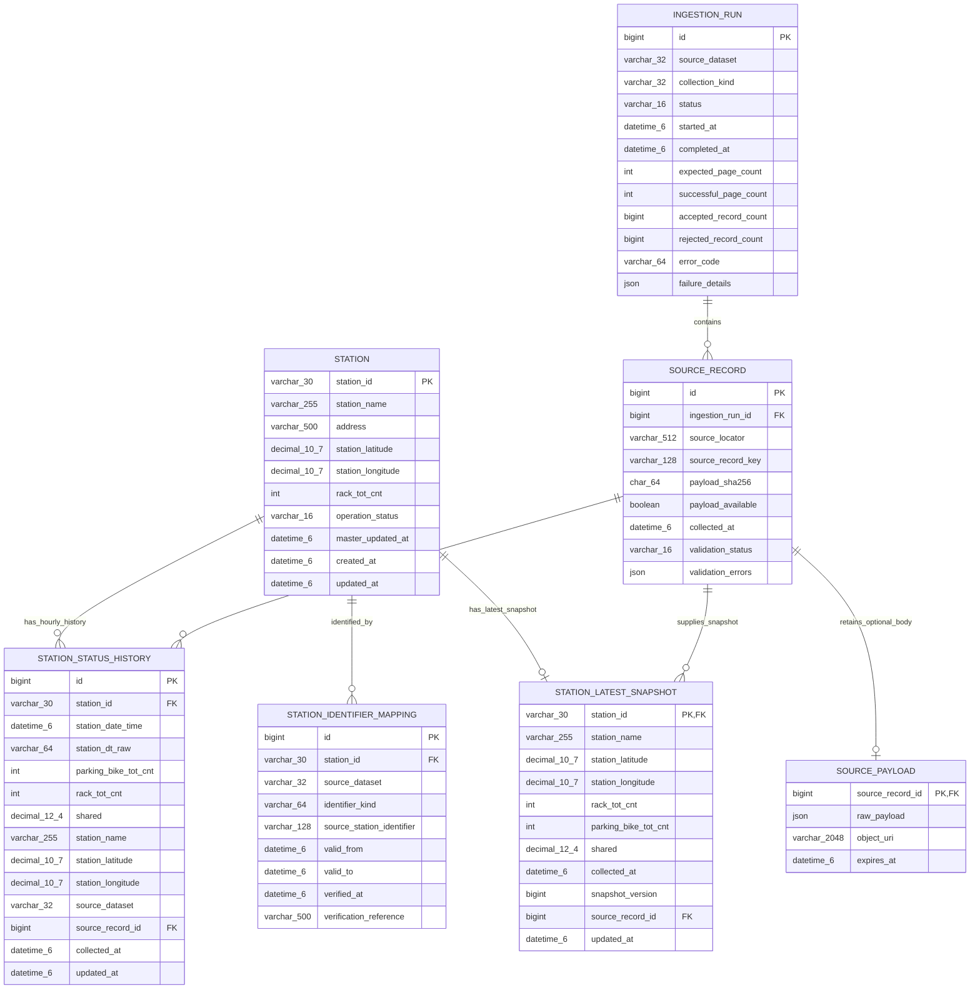
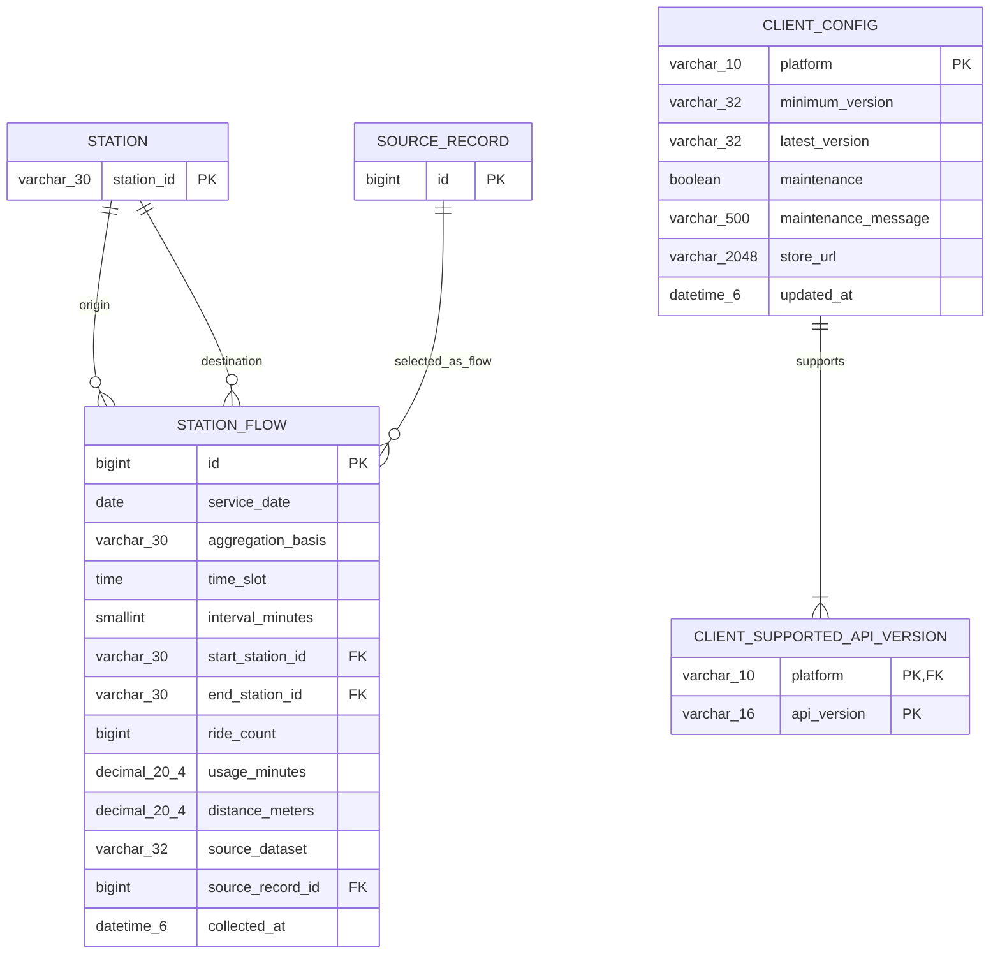

# 따릉이 Backend ERD — API 명세서 v5 기준

작성일: 2026-09-16  
기준 문서: [Backend API 명세서 v5](ddareungi_backend_api_spec_production_v5.md)  
범위: 비회원 대여소 조회·실시간 상태·장소 검색·복합 경로·예측·Client Config 및 데이터 수집

이 문서는 명세서를 구현하기 위한 **데이터 모델 설계안**이다. 현재 프로젝트 코드나 기존 DB 스키마를 기준으로 하지 않는다. 명세서가 확정하지 않은 테이블·자료형·저장 방식은 설계 제안이며, 실행 가능한 DB migration은 아니다.

> **사용자 결정 반영**: 공개 조회는 폐쇄·불완전 대여소 제외, FRESH·0대는 정상값, Redis 우선/MySQL fallback으로 확정한다. 이를 위해 최신 스냅샷과 출처 메타데이터 보존은 필수 기능으로 반영했다. ID 매핑은 검증 완료 행만 채택한다.

## 1. 저장소별 책임

| 저장소 | 관리 대상 | 기준 |
|---|---|---|
| MySQL | 대여소 기준정보, 최신 스냅샷, 원천 식별자 매핑, 시간별 이력 | 영구 보존 및 Redis 실패/누락 시 fallback |
| MySQL / Raw 저장소 | 필수 출처 메타데이터와 분리된 원문 본체 | 메타데이터는 참조 중 보존, 원문은 별도 보존 정책 |
| MySQL / 분석 저장소 | 대여·반납 흐름 | OA-21229 스키마 검증 후 선택 도입 |
| Redis | 현재 대여소 수량, 수집 상태, 선택적 장소/예측 캐시 | MySQL 대여소 기준정보에 결합 |
| Elasticsearch | 대여소 검색용 Document와 geo_point | MySQL에서 파생, 재생성 가능 |
| 설정 저장소 | 앱 최소/최신 버전, 점검, 지원 API 버전 | 파일/설정 서비스로도 가능. DB 관리 시 5장의 선택 ERD 사용 |
| 모델 아티팩트/설정 | Global Model, 모델 버전·지원 범위·confidence 규칙 | Prediction Service의 책임. 사용자별/대여소별 모델 테이블 불필요 |

API 응답 DTO 하나를 테이블 하나로 변환하지 않는다. 실시간 수량·거리·예측값·경로는 서로 다른 저장소 또는 계산 결과에서 조합한다.

## 2. 핵심 ERD

Mermaid를 지원하는 Markdown 뷰어에서 아래 다이어그램을 볼 수 있다. `||`는 정확히 하나, `o{`는 0개 이상을 뜻한다. 키 표시는 개별 컬럼의 역할이며 **복합 UNIQUE의 구성은 4장에 따로 정의**한다.

핵심 관계는 다음과 같다.

- 대여소 하나는 원천별 식별자 매핑과 시간별 이력을 여러 개 가진다.
- 수집 실행 하나는 여러 원천 레코드를 가진다. 전체 실패이면 레코드가 없어도 된다.
- 원천 레코드는 검증/매핑 실패 또는 중복으로 Canonical 이력을 만들지 않을 수 있다. 파일의 넓은 형식 한 행에 여러 시간 값이 있으면 여러 이력으로 변환할 수도 있다.
- Raw에는 미등록·잘못된 대여소 ID도 보존해야 하므로 `SOURCE_RECORD`에서 `STATION`으로 필수 FK를 걸지 않는다. 검증된 Canonical 이력에만 대여소 FK를 적용한다.

## 3. 테이블 정의

아래에서 `N`은 NOT NULL, `Y`는 NULL 허용이다. ID 크기와 문자열 길이는 제안값이며 실제 원천 샘플로 확인한다. `bigint` PK는 자동 증가 대리키로 제안한다. 모든 FK 컬럼은 참조 키와 자료형·길이·문자열 collation을 동일하게 맞춘다.

### 3.1 station — 대여소 기준정보

명세서 3.6·11·22장에 대응한다. 현재 수량은 별도 station_latest_snapshot에 보존한다. 공개 상태는 station.operation_status를 기준으로 Redis 공개 gate에도 동기화한다.

| 컬럼 | 타입 | NULL | 설명 |
|---|---|:---:|---|
| station_id | VARCHAR(30) | N | PK. 공개 식별자 `ST-*`; 이름이나 관리번호에서 임의 생성하지 않음 |
| station_name | VARCHAR(255) | Y | 원천에서 확인한 이름 |
| address | VARCHAR(500) | Y | 기준정보 주소 |
| station_latitude | DECIMAL(10,7) | Y | WGS84 위도 |
| station_longitude | DECIMAL(10,7) | Y | WGS84 경도 |
| rack_tot_cnt | INT | Y | 기준 거치대 수. 알 수 없으면 null |
| operation_status | VARCHAR(16) | N | ACTIVE / INACTIVE / UNKNOWN. ACTIVE만 공개 |
| master_updated_at | DATETIME(6) | Y | 기준정보를 마지막으로 성공 확인한 수집 시각 |
| created_at | DATETIME(6) | N | 등록 시각 |
| updated_at | DATETIME(6) | N | 이 행의 마지막 변경 시각 |

폐쇄 대여소와 과거에만 존재하는 대여소도 이력 참조를 위해 보존한다. 확인되지 않은 속성에 0좌표나 가짜 이름을 채우지 않는다. 이 때문에 DB의 이름·좌표는 nullable이다. **현재 Station API 응답에는 명세서의 non-null 이름·좌표를 만족하는 검증된 대여소만 노출**한다. INACTIVE/UNKNOWN 또는 기준정보 불완전 대여소는 주변·상세·Batch·경로·예측 대상에서 제외한다. 상세/예측은 404 STATION_NOT_FOUND, Batch는 excludedStationIds에 분류한다. 공개 대상의 일시적 실시간 조회 불가는 별도로 구분하고 API 11.0 결정표를 적용한다.

`operation_status`는 검증된 운영 정보로 갱신하는 필드다. 실시간 수량 0, 특정 수집 페이지 누락 또는 STALE을 운영 중단으로 해석하지 않는다. 폐쇄 ID를 삭제·재사용하지 않는다.

### 3.2 station_identifier_mapping — 원천 식별자 연결

명세서 3.1·3.6장의 서로 다른 식별자 결합을 지원한다. 이 테이블에는 검증이 완료된 매핑만 저장한다.

| 컬럼 | 타입 | NULL | 설명 |
|---|---|:---:|---|
| id | BIGINT | N | PK |
| station_id | VARCHAR(30) | N | FK → station.station_id |
| source_dataset | VARCHAR(32) | N | OA-13252 등 원천 namespace |
| identifier_kind | VARCHAR(64) | N | 원천 컬럼 의미: 관리번호 / 대여소ID 등 |
| source_station_identifier | VARCHAR(128) | N | 원천 문자열 그대로 보존; 앞자리 0 유지 |
| valid_from | DATETIME(6) | N | 확인된 매핑 적용 시작 시각 |
| valid_to | DATETIME(6) | Y | 적용 종료 시각, 미종료는 null |
| verified_at | DATETIME(6) | N | 매핑 검증 시각 |
| verification_reference | VARCHAR(500) | Y | 검증에 사용한 파일/문서 식별자 |

적용 구간은 `[valid_from, valid_to)`다. 같은 원천 식별자의 적용 구간이 겹치면 안 된다. 유효기간을 모르거나 검증되지 않은 매핑은 이 테이블에 저장하지 않는다. 원천 메타데이터의 validation_status=UNMAPPED 및 validation_errors에 후보 ID·사유를 기록해 재검증하며, 과거 전체 기간에 소급 적용하지 않는다. 과거 데이터는 관측 시각에 유효한 매핑을 사용한다. 이력에 저장한 Canonical ID는 이후 매핑 변경만으로 자동 재작성하지 않는다.

### 3.3 ingestion_run — 수집 실행 이력

명세서 21.2장의 전체 성공·부분 성공·실패 추적 및 필수 출처 참조를 지원한다.

| 컬럼 | 타입 | NULL | 설명 |
|---|---|:---:|---|
| id | BIGINT | N | PK. 수집 run ID |
| source_dataset | VARCHAR(32) | N | 실행에서 수집한 원천 |
| collection_kind | VARCHAR(32) | N | 제안: MASTER / REALTIME / HOURLY / FILE_IMPORT / FLOW_IMPORT |
| status | VARCHAR(16) | N | RUNNING / SUCCESS / PARTIAL / FAILED |
| started_at | DATETIME(6) | N | 시작 시각 |
| completed_at | DATETIME(6) | Y | 종료 전 null |
| expected_page_count | INT | Y | 사전에 확정할 수 없거나 파일 수집이면 null |
| successful_page_count | INT | N | 성공 페이지 수. 기본 0 |
| accepted_record_count | BIGINT | N | 검증/저장에 성공한 레코드 수. 기본 0 |
| rejected_record_count | BIGINT | N | 거부한 레코드 수. 기본 0 |
| error_code | VARCHAR(64) | Y | 내부 분류용 오류 코드 |
| failure_details | JSON | Y | 실패 페이지·누락 ID 등 구조화 정보; 키/원문 URL 제외 |

페이지 수가 맞다는 이유만으로 SUCCESS로 전환하지 않는다. 종료 조건과 필요한 검증·저장이 완료되어야 한다. API 인증키가 포함된 URL을 `failure_details`에 보관하지 않는다. 큰 실패 목록은 Raw 저장소의 파일로 분리하고 위치만 보관할 수 있다.

새 수집 결과는 출처 메타데이터와 MySQL 최신 스냅샷을 보존한 뒤 Redis에 반영한다. MySQL 저장 실패이면 해당 수집을 성공 처리하지 않는다. 기존 Redis의 유효 스냅샷을 읽는 요청은 MySQL 장애 중에도 제공할 수 있다. MySQL fallback이 필요할 때만 그 장애가 조회 결과에 영향을 준다.

### 3.4 source_record — 원천 보존 및 재처리

명세서 3.4~3.6·21장의 출처 추적을 위한 필수 메타데이터 테이블이다. 원문 본체는 source_payload로 분리한다.

| 컬럼 | 타입 | NULL | 설명 |
|---|---|:---:|---|
| id | BIGINT | N | PK |
| ingestion_run_id | BIGINT | N | FK → ingestion_run.id |
| source_locator | VARCHAR(512) | N | 파일 경로/버전 또는 인증키를 제거한 API 페이지 식별자 |
| source_record_key | VARCHAR(128) | N | 실행 안에서 유일한 `file-key:row-number` 또는 `page:row` |
| payload_sha256 | CHAR(64) | N | 원본 레코드 검증용 SHA-256. 원본 동일성 기준을 Adapter에서 고정 |
| payload_available | BOOLEAN | N | 원문 본체 조회 가능 여부. 본체 만료 시 false |
| collected_at | DATETIME(6) | N | 수집 시각 |
| validation_status | VARCHAR(16) | N | PENDING / VALID / INVALID / UNMAPPED |
| validation_errors | JSON | Y | 검증·매핑 실패 이유 |

CSV의 원본 바이트·인코딩·헤더는 Raw 원본 파일로 보존한다. source_locator는 파일/페이지의 식별자이며 원문 삭제 후에도 이 식별자·해시·행 위치를 유지한다. 재수집 결과는 다른 run으로 보존하고 같은 payload hash라도 관측 시각이 다를 수 있으므로 hash 전체 UNIQUE는 사용하지 않는다.

source_record는 참조 중인 station_status_history 또는 station_latest_snapshot이 있으면 삭제하지 않는다. ingestion_run도 연결된 source_record가 있는 동안 보존한다. 어떤 채택 데이터에서도 참조하지 않는 메타데이터는 감사 보존 기간 후 정리할 수 있다. 매분 전체 원문을 무기한 보존하는 정책은 아니다.

원문 본체는 아래 source_payload가 보관 위치와 수명을 관리한다. 원문 만료가 이력의 필수 FK를 끊지 않는다. UNMAPPED/PENDING 레코드는 재검증 기한을 두고 그 기한 전에 원문을 만료시키지 않는다. 만료 후 재처리는 원천 재확보 없이는 불가능할 수 있다.

### 3.5 station_status_history — 시간별 Canonical 이력

명세서 21.1장의 `station_status_history`를 그대로 사용한다. 분 단위 실시간 수집 테이블과 혼합하지 않는다.

| 컬럼 | 타입 | NULL | 설명 |
|---|---|:---:|---|
| id | BIGINT | N | PK |
| station_id | VARCHAR(30) | N | FK → station.station_id |
| station_date_time | DATETIME(6) | N | 원천 시간대를 해석한 관측 시간의 UTC 값 |
| station_dt_raw | VARCHAR(64) | N | 원천 시간 문자열 보존. 여러 시간 컬럼이면 원본은 source_payload.raw_payload 또는 Raw 파일에도 보존 |
| parking_bike_tot_cnt | INT | N | 해당 시각의 검증된 대여가능 수량 |
| rack_tot_cnt | INT | Y | 해당 원천이 제공하는 당시 거치대 수 |
| shared | DECIMAL(12,4) | Y | 당시 원천 거치율(%), 100 초과 허용 |
| station_name | VARCHAR(255) | Y | 원천이 제공한 당시 이름 스냅샷 |
| station_latitude | DECIMAL(10,7) | Y | 원천이 제공한 당시 위도 |
| station_longitude | DECIMAL(10,7) | Y | 원천이 제공한 당시 경도 |
| source_dataset | VARCHAR(32) | N | Canonical 값으로 선택한 원천 |
| source_record_id | BIGINT | N | FK → source_record.id; 선택된 원천 추적 |
| collected_at | DATETIME(6) | N | 선택된 원천을 수집한 시각 |
| updated_at | DATETIME(6) | N | 정규화/정정 결과를 갱신한 시각 |

`source_record_id`, `updated_at`은 추적성을 위한 추가 제안이다. 원문 컬럼은 유지했다. `source_dataset`은 원천 추적 경로와 중복되므로 Import 트랜잭션에서 참조 Raw의 run.source_dataset과 일치하는지 검증한다. 이를 DB 수준에서 강제하려면 원천 코드를 포함하는 복합 참조 설계를 migration 단계에서 추가한다.

수량 또는 관측 시각이 유효하지 않은 행은 Raw에서 거부 사유를 보존하고 Canonical 이력에는 넣지 않는다. 누락 시간대를 0대로 채우지 않는다. 당시 원천에 없는 좌표·이름·거치대 수를 현재 마스터 값으로 덮어 과거 사실처럼 저장하지 않는다. 필요하면 별도의 Feature 결합 과정에서 보강 여부를 표시한다.

### 3.6 station_latest_snapshot — MySQL fallback용 최신 유효 스냅샷

대여소별 최대 1건을 보존하며 시간별 학습 이력과 분리한다. ID는 station의 PK를 공유하고 이름·좌표·수량·수집 시각은 NOT NULL, rack_tot_cnt/shared만 nullable이다. collected_at은 실제 행을 성공 수집한 UTC 시각이다. source_record_id는 NOT NULL FK이며 updated_at은 DB 갱신 시각으로 최신성 계산에 사용하지 않는다.

snapshot_version은 수집 실행 시작 시 할당하는 단조 증가 BIGINT 버전으로 제안한다. 예를 들어 ingestion_run.id를 사용하고 모든 Collector가 같은 발급 원천을 사용한다. 같은 실행 안에서는 station_id별 한 결과만 채택하며 다음 조건을 원자적으로 검사한다: 저장된 버전보다 새로운 버전이고 collected_at이 역행하지 않아야 한다. 재시도에서 같은 버전·같은 내용은 멱등 성공으로 처리하고 같은 버전·다른 내용은 충돌로 기록한다. Redis 재적재 시 새 버전/수집 시각을 발급하지 않는다. 이전 실행의 늦은 완료가 새 값을 덮어쓰지 못하게 한다.

MySQL에 source_record 및 station_latest_snapshot을 트랜잭션으로 보존한 뒤 같은 내용으로 Redis를 반영한다. Redis 실패 시 재시도/대사하며 두 저장소의 원자적 동시 커밋을 가정하지 않는다. Redis key miss, timeout, 손상 또는 제공 상한 초과에 MySQL을 Batch 조회한다. fallback 응답에도 원래 collected_at으로 FRESH/STALE을 계산한다. 일반 조회에는 유효 FRESH·0대를 포함하고 onlyAvailable에는 포함하지 않는다.

스냅샷에 저장된 이름·좌표도 검증된 수집 데이터다. 필수값이 불완전한 새 행은 기존 유효 스냅샷을 덮어쓰지 않는다. 다만 마스터의 검증된 폐쇄/기준정보 무효화 결정은 기존 스냅샷의 공개를 차단한다. 최신 스냅샷이 존재하더라도 station.operation_status와 공개 필수 기준을 만족해야 한다.

### 3.7 source_payload — 원문 본체 및 보존 위치

| 컬럼 | 타입 | NULL | 설명 |
|---|---|:---:|---|
| source_record_id | BIGINT | N | PK 및 FK → source_record.id |
| raw_payload | JSON | Y | 원천 필드명·값·추가 필드 보존 |
| object_uri | VARCHAR(2048) | Y | Raw 파일/객체의 보관 위치. 자격증명 포함 금지 |
| expires_at | DATETIME(6) | Y | 원문 보존 종료 시각. null이면 별도 장기 보존 정책 |

raw_payload와 object_uri 중 정확히 하나를 사용한다. 파일 공유 시 source_record의 행 식별자로 해당 레코드를 찾는다. 원문 만료 시 본체/연결 행을 제거하고 source_record.payload_available=false로 변경하되 메타데이터는 유지한다. 공유 원본 파일은 참조하는 모든 레코드의 보존 기한·검증 대기 상태를 확인한 뒤 삭제한다. 초기 수집/파일 import에서 원문을 보관한 후 메타데이터를 확정하며 보존 기간 수치는 운영 설정으로 확정한다.

## 4. 키·인덱스·정합성 규칙

| 테이블 | 제약/인덱스 | 목적 |
|---|---|---|
| station | PK(station_id) | 영구 식별자 |
| station | INDEX(updated_at, station_id) — 선택 | Elasticsearch 증분 동기화 |
| station_identifier_mapping | UNIQUE(source_dataset, identifier_kind, source_station_identifier, valid_from) | 동일 원천 식별자의 시작 시각 중복 차단 |
| station_identifier_mapping | INDEX(station_id) | 대여소 기준 역조회 |
| ingestion_run | INDEX(source_dataset, started_at) | 최근 실행 및 장애 추적 |
| source_record | UNIQUE(ingestion_run_id, source_record_key) | 동일 실행 내 행 중복 방지 |
| station_status_history | UNIQUE(station_id, station_date_time) | 대여소·시간별 Canonical 1건 |
| station_status_history | INDEX(station_date_time, station_id) — 선택 | 전체 대여소의 시간 구간 학습 조회 |
| station_status_history | INDEX(source_record_id) | 원천 추적/FK 지원 |
| station_latest_snapshot | PK(station_id), FK(station_id), INDEX(source_record_id) | 대여소별 최신 1건, 출처 참조 |
| source_payload | PK(source_record_id), FK(source_record_id) | 메타데이터와 원문 본체 1:0..1 연결 |

`UNIQUE(station_id, station_date_time)`와 똑같은 보조 인덱스를 다시 만들지 않는다. FK용 인덱스가 이미 생성되어 있으면 중복 추가하지 않는다. 선택 인덱스는 실제 쿼리와 적재 비용을 확인한 뒤 도입한다.

DB CHECK 또는 입력 검증으로 다음 규칙을 적용한다.

- 알려진 수량·거치대 수는 0 이상이며 `parking_bike_tot_cnt <= rack_tot_cnt` 제약을 두지 않는다. 거치율도 100 이하로 제한하지 않는다.
- 좌표는 유한한 WGS84 범위여야 한다. DB에 위도·경도를 저장할 때 둘 다 null이거나 둘 다 유효하도록 검증한다.
- `valid_to`는 null 또는 `valid_from`보다 커야 한다. 동일 식별자의 기간 겹침은 단순 UNIQUE로 막을 수 없으므로 키 단위 직렬화/락을 사용하는 매핑 갱신 트랜잭션에서 검사한다.
- 카운트는 음수일 수 없다. 종료 시각은 시작보다 빠를 수 없고 RUNNING이면 completed_at은 null이다.
- 폐쇄 대여소는 논리 상태를 변경한다. station 및 채택된 source_record 삭제는 기본 RESTRICT로 두고 이력을 CASCADE 삭제하지 않는다.
- 같은 대여소·시각에 여러 원천 값이 있으면 Raw는 모두 보존한다. 우선순위/정정 정책 확정 전 Canonical을 임의로 덮어쓰지 않는다. 정정 시 이전 Raw는 남기고 선택 출처·변경 사유를 감사 기록으로 보존한다.

시간 컬럼은 이 설계에서 모두 **UTC DATETIME(6)** 으로 저장하고 DB 세션/ORM 설정도 UTC로 통일한다. DATETIME 자체에 시간대가 들어가는 것은 아니다. `stationDt=2026091620`을 한국 시각으로 해석하면 저장값은 `2026-09-16 11:00:00`이며 API 출력에서는 `2026-09-16T20:00:00+09:00`으로 표시할 수 있다. 원천 집계의 날짜/시간은 아래 흐름 테이블처럼 별도 보존한다.

학습 데이터는 관측 시각만 필터링하지 말고 당시 사용 가능했던 수집/발행 시점도 고려하여 미래 정보 유출을 방지한다. 전체 Canonical 정정 이력을 재현해야 한다면 별도 버전 이력 테이블을 추가해야 하며 현재 표만으로 모든 과거 학습 상태를 재현할 수 있다고 가정하지 않는다.

## 5. 선택 ERD — 흐름 데이터와 Client Config

아래 테이블은 핵심 대여소 조회를 구현하기 위해 모두 필수인 것은 아니다. 흐름 데이터는 원본 파일 검증 후, Client Config는 DB에서 운영자가 관리할 때 도입한다.

### 5.1 station_flow — 대여·반납 흐름

명세서 3.5장의 분석/AI Feature용이다. **OA-21229의 실제 집계 방식·헤더·단위는 검증 대기**이므로 테이블명에 `5m`을 고정하지 않았다.

- `id`는 PK, 출발/도착 ID는 각각 station FK, `source_record_id`는 source_record FK다. 모든 컬럼은 원천 검증이 끝난 Canonical 행에서는 NOT NULL을 제안한다. 원천에 총 이용시간/거리가 없으면 해당 두 컬럼의 nullable 정책부터 다시 확정한다.
- 복합 UNIQUE 제안: `(service_date, aggregation_basis, time_slot, interval_minutes, start_station_id, end_station_id)`. 원본에 이 키 외의 집계 차원이 있으면 그 차원을 추가하기 전에는 적재하지 않는다.
- INDEX 제안: `(start_station_id, service_date, time_slot)`, `(end_station_id, service_date, time_slot)`. 명세서의 유입/유출 시간대 Feature에 대응한다.
- `service_date`와 `time_slot`은 원천 집계의 Asia/Seoul 날짜·시각이다. `aggregation_basis`가 출발 기준인지 도착 기준인지 보존한다. 둘을 같은 집계로 단순 합산하면 이중 집계가 될 수 있다.
- `ride_count`는 0 이상의 정수다. 이용시간과 거리는 원천 단위를 확인한 뒤 분·m로 변환한다. 변환 전 원본 값은 Raw에 보존하고 소수/반올림 정책을 확정한다.
- 이 값으로 현재 `parkingBikeTotCnt`를 대체하지 않는다. 실시간 수량은 재배치·정비 등의 영향도 받으므로 대여/반납 차이만으로 재구성하지 않는다.
- 중복 원천 선택·출처 일치·삭제 정책은 station_status_history와 동일하다. 이름 등 원본 추가 컬럼은 source_payload 또는 Raw 파일에 보존한다.

### 5.2 client_config / client_supported_api_version

명세서 6장에 대응하는 **선택적 영구 설정 모델**이다. 설정 파일로 관리하는 경우 두 테이블 모두 생략할 수 있다.

| 컬럼 | NULL | 규칙 |
|---|:---:|---|
| client_config.platform | N | PK, android / ios / web |
| minimum_version | 조건부 | 모바일 필수, web은 null |
| latest_version | 조건부 | 모바일 필수, web은 null |
| maintenance | N | 점검 여부 |
| maintenance_message | 조건부 | 점검 중 안내 문자열, 아니면 null |
| store_url | 조건부 | 모바일 배포 URL, web은 null |
| updated_at | N | 설정 갱신 시각 |
| client_supported_api_version.platform | N | 복합 PK 일부, FK → client_config.platform |
| client_supported_api_version.api_version | N | 복합 PK 일부, 예: v1 |

플랫폼별 최소 1개의 지원 API 버전이 있어야 한다. 이 최소 개수는 FK만으로 강제되지 않으므로 설정 갱신 트랜잭션에서 검증한다. minimum/latest는 숫자 구성요소로 비교하고 문자열 사전순 비교를 사용하지 않는다.

`forceUpdate`, `updateAvailable`은 요청 appVersion과 설정을 비교하는 계산 결과이므로 저장하지 않는다. `appVersion`, `buildNumber` 같은 방문 클라이언트 정보도 이 설정 테이블에 저장하지 않는다. 점검 설정의 캐시 무효화와 실제 서버 기능 차단을 함께 적용한다.

## 6. Redis / Elasticsearch 모델

이 항목은 관계형 ERD의 FK가 아닌 **동일 stationId를 사용하는 논리 연결**이다.

### Redis

| Key / 용도 | 값 | 수명 및 정합성 |
|---|---|---|
| station:realtime:{stationId} | 원천 필드명 + realtimeUpdatedAt + snapshotVersion + operationStatus/publicationEligible | 제안 TTL 900초, 제공 상한 600초. 미조회 시 MySQL fallback |
| station:realtime:last-success-at | 마지막 전체 수집 성공 시각 | 별도 보존; 개별 데이터가 만료해도 이력이 사라지지 않도록 함 |
| station:realtime:last-attempt-at | 마지막 수집 시도 시각 | 성공 시각과 분리 |
| 예측 캐시(선택) | stationId + targetAt + modelVersion + featureSnapshotVersion 및 예측 응답 | 입력·모델 갱신에 따른 무효화/유효기간 필요 |
| 장소 캐시(선택) | Provider·검색어·위치 힌트·limit·언어 조건별 결과 | Provider 약관과 위치정보 보존 정책 준수 |

실시간 값이 Redis String JSON이면 MGET, Hash이면 Pipeline을 사용한다. `realtimeStatus`와 `realtimeAgeSeconds`는 응답 시각으로 계산하는 값이므로 저장된 상태를 그대로 믿지 않는다. 오래된 수량을 공개에서 제외하고 MySQL fallback을 시도할 시점과 키 물리 만료 시점은 다르다. 갱신 시 값+TTL을 원자적으로 처리하고 이전 수집 결과가 최신 결과를 덮어쓰지 못하게 한다.

### Elasticsearch

Index 예시 이름은 `stations`이며 Document ID는 `stationId`다.

| 필드 | 논리 타입 | 출처 |
|---|---|---|
| stationId | keyword | station.station_id |
| stationName | text + 정렬용 keyword | station.station_name |
| address | text | station.address |
| location | geo_point | station_latitude / station_longitude |
| operationStatus | keyword | station.operation_status |
| updatedAt | date | station.updated_at |

좌표·이름이 유효하고 노출 정책을 만족하는 대여소만 검색 대상에 포함한다. geo_point 객체는 `{ "lat": ..., "lon": ... }`를 사용해 순서 혼동을 줄인다. 사용자 API의 `distanceMeters`는 요청 좌표에 대한 계산값이다.

현재 자전거 수를 검색 인덱스의 영구 기준값으로 두지 않는다. 반경 후보에 Redis 우선/MySQL fallback 스냅샷을 결합한 뒤 공개 gate·최종 좌표 반경을 확인하고 필터·정렬·limit를 적용한다. DB 변경과 Elasticsearch 반영은 하나의 원자 트랜잭션이 아니므로 재시도·주기적 대사·재색인 정책이 필요하다. Outbox/CDC가 필요하면 별도 운영 테이블을 추가할 수 있으나 이 ERD의 필수 범위에는 포함하지 않았다.

## 7. API와 데이터 모델 연결

| API | 영구 데이터 | 실시간/계산/외부 데이터 |
|---|---|---|
| GET /api/client-config | 선택: client_config 및 지원 버전 | 요청 앱 버전 비교 |
| GET /api/v1/stations/nearby | station, station_latest_snapshot | Elasticsearch 후보 + Redis 우선/MySQL fallback + 최종 거리 계산 |
| GET /api/v1/stations/{stationId} | station, station_latest_snapshot | 공개 gate + Redis 우선/MySQL fallback, age/status 계산 |
| GET /api/v1/stations/realtime | station, station_latest_snapshot | Batch fallback, 미존재/정책 제외/조회 불가 ID 분리 |
| GET /api/v1/places/search | 필수 테이블 없음 | PlaceSearchProvider, 선택 캐시 |
| POST /api/v1/routes/search | station, station_latest_snapshot | 공개 후보의 Redis 우선/MySQL fallback + 경로 Provider |
| GET /api/v1/stations/{stationId}/predictions | station; 모델 학습은 station_status_history 및 선택 flow | PredictionProvider, 현재 상태, 선택 캐시 |
| GET /api/v1/stations/{stationId}/predictions/timeline | 위와 동일 | 시간별 예측 포인트 |
| GET /api/v1/status/realtime | station 공개 대상; ingestion_run 수집 이력 | Redis 우선/MySQL fallback 후 대여소별 최신성 집계 |

예측 API 요청마다 전체 학습 이력을 조회해 모델을 학습하지 않는다. 학습·Feature 생성과 온라인 추론을 분리한다. 반경 검색/길찾기에 필요한 사용자 위치, 검색 기록, routeId는 명세서에서 영구 저장을 요구하지 않으므로 별도 테이블을 만들지 않았다. `requestId`는 관측성 로그의 추적 값이며 대여소 업무 테이블의 FK가 아니다.

회원·즐겨찾기·운동 기록·경로 저장·피드백은 향후 도메인으로 제외했다. 반납 가능 슬롯 테이블도 신뢰 가능한 원천이 확보되기 전에는 만들지 않는다.

## 8. 구현 전에 확정할 항목

1. 원천별 대여소 식별자 및 매핑의 실제 유효기간, 시간 필드·단위·파일 헤더. 검증 대기는 source_record에 남기고 채택 매핑 테이블에는 넣지 않는다.
2. Raw 보존 저장소와 보존 기간, 실시간 원문 저장 여부, 실패/정정 감사 기록 정책.
3. 같은 시간의 여러 원천 중 Canonical 선택 우선순위 및 재처리 규칙.
4. 확정된 폐쇄·불완전 대여소 제외 정책의 Redis gate/검색 인덱스 동기화·재시도 절차.
5. 흐름 데이터의 실제 집계 차원과 시간 단위. 확인 전 station_flow 물리 스키마 확정 금지.
6. Client Config의 설정 파일/DB 관리 방식과 변경 반영 절차.
7. 이력 데이터 증가량에 따른 인덱스·보관·분석 저장소 전략. 파티셔닝 선택 시 PK/UNIQUE/FK 제약을 해당 DB 버전에서 별도 검증.

관계·키·null 규칙은 이 문서의 설계안이며 DDL 적용이나 MySQL에서의 실행 검증까지 완료된 상태는 아니다.
